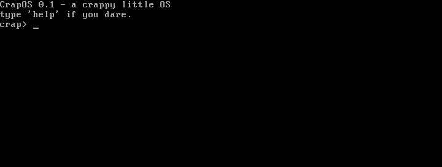

# CrapOS

A crappy little operating system in 16-bit x86 assembly. It boots from a floppy image through legacy BIOS, loads a second stage from disk, and drops you into a tiny shell.



The same session as text:

```
CrapOS 0.1 - a crappy little OS
type 'help' if you dare.
crap> help
Commands:
  help    - this list
  reboot  - restart the machine
  clear   - wipe the screen
  crap    - say something unhelpful
crap> crap
[crap] 640 KB ought to be enough for anybody.
crap> x
that's not a command. nice try, genius.
crap>
```

(Recorded from QEMU. `crap` picks a line from the timer, so yours will differ. A still frame is in [docs/media/crapos.png](docs/media/crapos.png).)

## How it works

- **Stage 1** (`src/stage1.asm`): the 512-byte boot sector. The BIOS loads it at `0x7C00`. It sets up the segments and stack, remembers the boot drive from `DL`, and reads 4 sectors from disk (`int 0x13`, with retries) to `0x7E00`, then jumps there.
- **Stage 2** (`src/stage2.asm`): the shell, at `0x7E00`, up to 2 KB. It reads keys with `int 0x16` into a 64-byte line buffer (with backspace), looks the line up in a command table, and runs it. The `crap` command picks its line from the BIOS tick counter (`int 0x1A`).
- Everything goes through BIOS interrupts, in real mode, for good. See [docs/adr/0001-real-mode-and-bios-only.md](docs/adr/0001-real-mode-and-bios-only.md).

## Build and run

Needs [NASM](https://www.nasm.us/) and [QEMU](https://www.qemu.org/) (`brew install nasm qemu` on macOS).

```
make          # build build/crapos.img (a 1.44 MB floppy image)
make run      # boot it in a QEMU window
make check    # run the boot tests (headless QEMU, about 20 seconds)
make clean
```

You can also write `build/crapos.img` to a floppy or load it in VirtualBox as a floppy disk; I've only tested it in QEMU.

## Testing

`make check` runs `tests/boot_tests.py`, which boots the image in headless QEMU, types into the shell with QMP `send-key`, and polls the VGA text buffer for the expected output (no fixed sleeps). Each scenario gets a fresh VM:

- Boots to the prompt on the `pc`, `isapc` and `q35` machine types, and from an IDE disk as well as a floppy (so the boot drive number isn't assumed).
- Every command: `help`, `reboot` (the OS restarts), `clear`, `crap` (only prints lines from its table), and unknown or empty input.
- Line editing: backspace, backspace on an empty line, and typing past the 64-byte buffer.
- Stage 1's disk-read failure message, using QEMU's `blkdebug` to fail a read on an IDE disk. (QEMU's floppy controller swallows read errors, so a floppy can't be used for this.)

The build also checks that the boot sector is exactly 512 bytes and ends in `55 AA`. Run one scenario with `python3 tests/boot_tests.py -k backspace`. I broke the OS on purpose in six ways to check that the matching test fails each time. Not covered: real hardware, VirtualBox and Bochs. The notes behind these choices are in [docs/research/qemu-boot-testing.md](docs/research/qemu-boot-testing.md).

## Layout

```
src/stage1.asm       boot sector: loads stage 2 from disk
src/stage2.asm       the shell and its commands
tests/boot_tests.py  headless QEMU boot tests
docs/adr/            architecture decision records
docs/research/       notes on how boot code is tested
```
